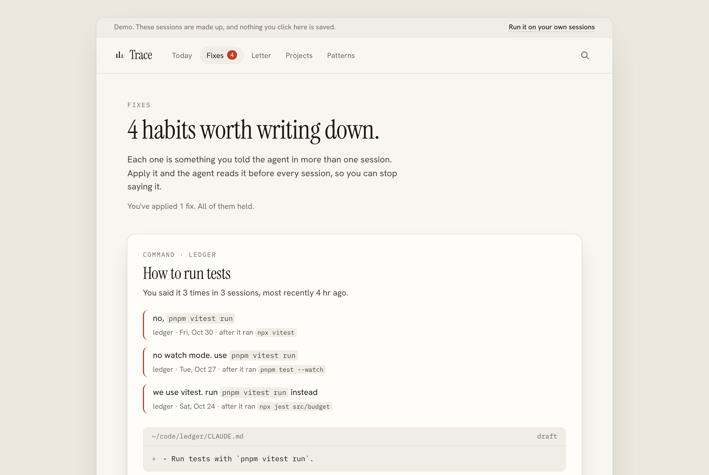
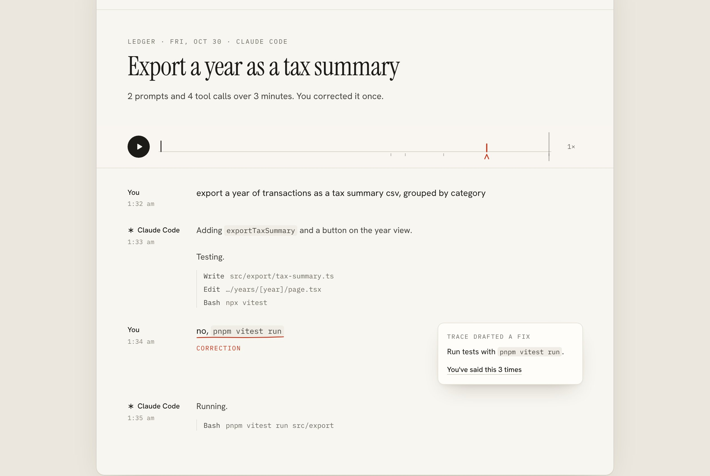

# Trace

<picture>
  <source media="(prefers-color-scheme: dark)" srcset=".github/readme/fixes-dark.jpg">
  
</picture>

I tell my coding agent the same things over and over. Use pnpm. Run the tests with `pnpm vitest run`. Stop writing comments that restate the code. Each correction costs a turn, and the agent forgets it by the next session.

Trace reads the session files Claude Code and Codex write to disk, finds the corrections you keep repeating, and drafts the line for your CLAUDE.md that would have saved you the trouble. You apply it in one click, as a local edit or a pull request. Then Trace watches whether you ever have to say it again.

**[Try the demo →]({{DEMO}})** It runs on made-up sessions, and nothing you click is saved.

## What it does

- **Fixes.** A correction is a redirect ("no, use pnpm"), an interrupt, a rejected tool call or a package manager swap. When the same one shows up in two or more sessions, Trace quotes every time you said it and drafts one line. Project habits go to that project's CLAUDE.md. Habits you repeat across projects go to `~/.claude/CLAUDE.md`.
- **Apply or open a PR.** Apply writes the line under a "Notes from Trace" heading. Open PR does the same on a fresh branch in a throwaway worktree, pushes it and opens the PR with `gh`, so your checkout and uncommitted work stay put.
- **Held or said again.** After you apply a fix, Trace keeps counting. A fix that holds turns green. A fix you had to repeat says so.
- **Today.** Every prompt of the day on one strip, as tall as it was long, with corrections marked in red.
- **Replay.** Play any session back at its own pace. Corrections get underlined as they arrive, with the fix they fed beside them.
- **The letter.** Every Friday at 5pm Trace writes a short letter about your week: what you built, what you corrected, which fixes held. It lands in `~/Trace/letters/` as markdown.
- **Search, Projects and Patterns.** Full-text search across every prompt, each project's history, and whether you're correcting less over time.



## Run it

```bash
pnpm install
pnpm dev
```

That starts the watcher and the dashboard at http://localhost:3000. Use Node 22. If pnpm says it skipped build scripts, run `pnpm approve-builds` and allow `better-sqlite3`.

Your sessions stay on your machine. The database lives at `~/Trace/trace.db`, and Trace never calls a model.

```bash
pnpm demo     # the dashboard on made-up sessions, nothing read from disk
pnpm letter   # write this week's letter to ~/Trace/letters/ now
pnpm test     # vitest across every package
```

## Status

Pre-v1. Every page works on real sessions and in the demo. The coach, replay, the letter and Codex support are new, and the correction rules will keep getting tuned against real habits.

## FAQ

**Does Trace send my sessions anywhere?**
No. It reads files on disk, writes to a local SQLite database, and touches the network only when you press Open PR (`git push` and `gh`).

**Does it use an LLM to judge my prompts?**
No. Everything is counting and quoting. A fix only exists because you said the same thing in more than one session, and Trace shows you each time.

**What if a drafted line is wrong?**
Dismiss it and Trace won't draft it again. Restore it from the same page if you change your mind.

**Which agents does it read?**
Claude Code from `~/.claude/projects/` and Codex from `~/.codex/sessions/`.

## How it's built

Node 22 and strict TypeScript in a pnpm workspace. SQLite through `better-sqlite3` and Drizzle, FTS5 for search, chokidar for the watcher, and a Next.js 15 dashboard with Tailwind and hand-drawn SVG.

```
apps/dashboard/   Next.js dashboard reading from SQLite
apps/watcher/     tails session files, writes rows and the Friday letter
packages/coach/   corrections, fixes, CLAUDE.md edits, PRs, the letter
packages/db/      schema, migrations and queries
packages/demo/    the made-up sessions behind the demo
packages/ingest/  turns parsed lines into rows
packages/parser/  Claude Code and Codex line parsing
packages/shared/  schemas, types and paths
```

The demo builds its database in memory from scripts in `packages/demo`, run through the same parser and ingest code as your real sessions.

## License

MIT. See [LICENSE](LICENSE).
